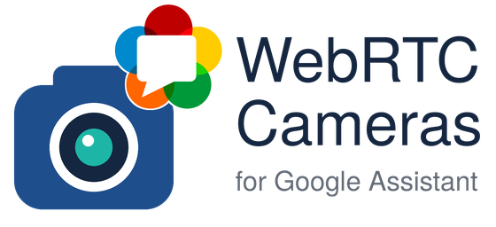

<p align="center">
  
</p>

[](https://github.com/hacs/integration)
[](https://github.com/giunatale/google-assistant-cameras-webrtc/actions/workflows/validate.yml)
[](https://github.com/giunatale/google-assistant-cameras-webrtc/actions/workflows/tests.yml)

A Home Assistant custom integration that makes **"Hey Google, show the front door"** on a Nest display play your camera over **WebRTC** instead of HLS.

Stock Home Assistant only offers Google the HLS stream: on a Nest Hub that means roughly 15–20 seconds before the first picture and a similar delay behind live, for every camera brand. Google's displays also support WebRTC, and every camera that has a WebRTC player in Home Assistant (anything go2rtc can serve, which is most RTSP cameras) can deliver it. This integration tells Google about it and does the signalling. Nothing else changes: HLS remains the fallback for everything WebRTC can't do.

**Install = on.** There is nothing to configure. Remove the integration and Google Assistant goes back to stock behaviour.

## How it works

```
"Hey Google, show the gate"
        │
        ▼
Google cloud ── EXECUTE GetCameraStream ──▶ Home Assistant (google_assistant / Nabu Casa)
                                               │ the camera trait, extended by this integration
                                               │ Nest display asked for WebRTC?  →  one-time signalling URL + token
                                               │ anything else (phone, Chromecast, tripped camera) → stock HLS
                                               ▼
Nest display player ── POST offer ──▶ /api/webhook/<per-session secret>
                                               │ camera's WebRTC provider (go2rtc) answers,
                                               │ all ICE candidates are gathered into the answer
             ◀── {action: answer, sdp} ─────────┘
Nest display ◀═══ video/audio over ICE/DTLS/SRTP, straight from go2rtc on your LAN ═══
```

1. On every Google **SYNC**, cameras that Home Assistant can serve over WebRTC are advertised as `["webrtc", "hls"]` instead of `["hls"]`. Google picks the first protocol the target surface supports.
2. When a Nest display asks for the stream, the integration answers with a signalling URL that is unique to that request (a fresh 256-bit secret, valid for 90 seconds, bound to that one camera) instead of an HLS URL.
3. The display posts its WebRTC offer to that URL. The camera's WebRTC provider inside Home Assistant (go2rtc for most cameras) produces the answer; since Google's player does not support trickle ICE, the candidates are collected and folded into the answer before it is returned.
4. Media flows directly between the display and go2rtc. When the provider is go2rtc, the integration checks a few seconds later that bytes are actually flowing to the display.
5. Anything that goes wrong turns that camera back to HLS: a camera whose video codec the display cannot play is marked unsupported (with a repair issue you can use to retry), a camera that fails twice in a row is put back on HLS for 30 minutes (doubling on repeats, 24 h max). Each change triggers a Google device sync so the displays follow.

## Requirements

- **Home Assistant 2026.10 or newer** (needs Python 3.14). Developed and tested on 2026.10 (HA OS). The integration verifies the internals it relies on at startup and stands down with a repair issue instead of breaking anything if a future release changes them.
- **Google Assistant linked** either through **Nabu Casa** or a **self-hosted Actions project** (the `google_assistant:` YAML integration). Both use the same code path in Home Assistant and both are supported. For automatic device syncs a self-hosted project needs the `service_account:` configured (the same thing that enables `google_assistant.request_sync` and report state); without it you will be asked to say "Hey Google, sync my devices" whenever the advertised cameras change.
- **Cameras with WebRTC in Home Assistant**: if the camera's more-info dialog already plays WebRTC (the default with the built-in go2rtc for RTSP cameras), it qualifies. Cameras without WebRTC keep HLS, untouched.
- **Camera video in H.264 or VP8, 480p–1080p** — Google's requirement for its displays. HEVC/H.265 cameras need an H.264 sub-stream exposed as its own camera entity. Audio is played if it is Opus, G.711 PCMU or G.722; other audio codecs (AAC is common) give video without sound.
- **An HTTPS URL for Google.** Home Assistant hands Google the same URL it uses for HLS today (Settings → System → Network, internal URL first, external URL if preferred). It must be `https://` with a certificate the display trusts, and reachable from the display. This is exactly what casting a camera from Home Assistant already requires; if that works, you are set. Without HTTPS the integration keeps stock behaviour and raises a repair issue explaining why.
- **A network path for media.** The display connects to the ICE candidates go2rtc produces: the Home Assistant host's LAN addresses on random UDP ports (plus TCP 18555 for HA's built-in go2rtc). Same LAN, or routed VLANs without a firewall in the way, is fine. If the display cannot reach them, the integration notices (go2rtc provider only) and falls back to HLS for that camera.

## Supported targets

| Target | Protocol | Notes |
| --- | --- | --- |
| Nest Hub, Nest Hub Max, Nest Hub (2nd gen) | **WebRTC** | Google asks for `webrtc` only on these; near real time |
| Chromecast with Google TV / Google TV Streamer | HLS | Google routes these through its Cast path and asks for Cast protocols, not WebRTC |
| Phones, Android TV, other Cast devices | HLS | unchanged |

Whatever the target asks for is what it gets; nothing is forced.

## Installation

1. HACS → Integrations → ⋮ → **Custom repositories** → add `https://github.com/giunatale/google-assistant-cameras-webrtc` as an **Integration**.
2. Search for **Google Assistant WebRTC Cameras**, download it, restart Home Assistant.
3. Settings → Devices & services → **Add integration** → Google Assistant WebRTC Cameras. Confirm. That's all.
4. The integration asks Google to sync your devices (automatic with Nabu Casa or a service account). If it can't, a repair issue tells you to say **"Hey Google, sync my devices"**.

Then say "Hey Google, show &lt;camera&gt;" to a Nest display.

## Verifying it works

The quickest check is the display itself: the picture appears within a few seconds (the remaining wait is your camera's keyframe interval) and the overlay clock, if your camera has one, is at most a second or two behind.

For the actual evidence, enable debug logging for the integration. In `configuration.yaml`:

```yaml
logger:
  logs:
    custom_components.google_assistant_cameras_webrtc: debug
```

or temporarily, with the `logger.set_level` action:

```yaml
action: logger.set_level
data:
  custom_components.google_assistant_cameras_webrtc: debug
```

At the default level the integration is quiet: INFO when it activates or a camera's WebRTC is re-enabled, WARNING whenever it falls back or stands down. At DEBUG you see the whole path of one request:

```
SYNC camera.gate: advertising ['webrtc', 'hls']
EXECUTE camera.gate: target wants ['webrtc'] (StreamToChromecast=False) -> WebRTC session 7c1d20aa (signalling via webhook, 1 STUN server(s) passed)
session 7c1d20aa: offer received for camera.gate (auth header: present, origin header: present, deviceId: ok)
session 7c1d20aa: offer 3012 bytes, display accepts video ['VP8', 'RTX', 'H264'], audio ['OPUS', 'PCMU']
session 7c1d20aa: answer from provider in 84 ms, 4 candidates gathered in 612 ms {'host/udp': 2, 'host/tcp': 1, 'srflx/udp': 1}, video ['H264'], audio ['PCMU'], bundle=True rtcp-mux=True
session 7c1d20aa: media flowing to the display (connected, 184320 bytes sent)
session 7c1d20aa: end received for camera.gate ...
session 7c1d20aa: closed (end)
```

The offer and answer SDPs are logged too, with addresses and ICE secrets redacted. Tokens are never logged.

**Diagnostics** (Settings → Devices & services → the integration → ⋮ → Download diagnostics) show the patch state, which Google link was found, every camera with the reason it is or isn't offered WebRTC, the breaker states, counters and the last 20 sessions with their timings and outcomes. No URLs, hostnames, tokens or addresses are included.

## Fallbacks and stand-downs

The integration never makes casting worse than stock Home Assistant: whenever it cannot do WebRTC it does exactly what stock does.

| Situation | Behaviour |
| --- | --- |
| Target doesn't ask for WebRTC (phone, Chromecast) | stock HLS, per request |
| Camera has no WebRTC in Home Assistant | advertised as stock, HLS |
| HA's URL for Google is not HTTPS | all cameras stock; repair issue *WebRTC for Google Assistant needs an HTTPS URL* (clears itself once fixed) |
| Display can't play the camera's video codec (HEVC) | one failed attempt, then HLS for that camera until you retry; repair issue *&lt;camera&gt;: WebRTC disabled* with a retry button |
| Two consecutive failures (provider error, timeout, no media reaching the display) | HLS for that camera for 30 min, doubling on repeats; re-enabled automatically |
| Google asks for WebRTC only but the camera just tripped | HLS anyway, and a device sync is requested so Google updates its list |
| Home Assistant changed the camera trait | integration inactive; repair issue *is inactive* |
| Home Assistant gained native WebRTC for Google | integration inactive; repair issue *is no longer needed* |
| Device sync could not be requested | repair issue *Say "Hey Google, sync my devices"*; clears when the sync arrives |

A trip or a retry changes what is advertised, and Google only learns about it at the next SYNC. With Nabu Casa or a service account that sync is requested immediately; until it lands (a few seconds), a display may still ask for WebRTC and show an error for that camera.

## Troubleshooting

- **Nothing changed, the Hub still takes 15 s.** Check the log for `SYNC camera.xxx: advertising ['webrtc', 'hls']`. If you only see `stock protocols`, the reason is right there (no WebRTC in HA, no HTTPS, tripped). If you see nothing at all, Google hasn't synced since the install: say "Hey Google, sync my devices".
- **EXECUTE shows `target wants ['progressive_mp4', 'hls', ...]`.** That target is on Google's Cast path (Chromecast, Google TV Streamer, some TVs). Google decides this, not Home Assistant.
- **Offer received, answer returned, then a black screen or an error on the display.** Media isn't reaching the display. Look for `no media reached the display` in the log: the display can't connect to go2rtc's candidates (firewalled VLAN, UDP blocked). Fix the network path or accept HLS.
- **`WebRTC negotiation ... failed: go2rtc_webrtc_offer_failed: streams: codecs not matched`.** The camera streams HEVC (or VP9/AV1). Expose an H.264 sub-stream as its own camera entity and use that one with Google.
- **The picture takes 3–4 s to appear.** That is the camera's keyframe interval: WebRTC decoders need a keyframe to start. Shorten the GOP/I-frame interval in the camera, if it allows it.
- **Video but no audio.** The camera's audio is AAC or another codec Google's player doesn't take. Switch the camera to G.711 (PCMU) if it can, or live without audio.
- **Repair issue "Say Hey Google, sync my devices" keeps coming back.** The integration can't reach Google's HomeGraph: self-hosted projects need `service_account:` in `google_assistant:`; Nabu Casa needs Google Assistant enabled in the cloud settings.
- **Something looks wrong and you want stock back right now.** Remove the integration. It requests a final sync and your cameras are stock again.

## Limitations and caveats

- One-way video (and audio from the camera). No talk-back: Google's WebRTC for third-party cameras is half-duplex.
- Only Google Nest displays use WebRTC today; Google routes Chromecast/Google TV devices and phones through their existing paths.
- First-frame latency is bounded by the camera's keyframe interval; this integration can't ask the camera for a keyframe.
- Google's displays decode H.264/VP8 at 480p–1080p. Streams above 1080p are rejected by the display; use a sub-stream.
- The breaker learns from failures, which means the first failure of a camera that will never work (codec) is visible once on the display.
- Automatic re-syncs depend on your Google link (Nabu Casa, or a service account for self-hosted projects). Without one, every change of the advertised set needs a manual "sync my devices".
- The media-flow check works only with go2rtc as the provider (the default). Cameras served by a native WebRTC integration are not checked after signalling; a non-working network path for those is not detected.
- This integration extends a class inside Home Assistant's `google_assistant` integration at runtime (there is no official hook for this). It verifies the exact shape it expects before touching anything and restores it on unload; if Home Assistant changes that code, the integration stands down with a repair issue rather than guessing. Updating Home Assistant is always safe.
- `cameraStreamNeedAuthToken` is left at Home Assistant's stock value (`false`); the token is still sent and verified when the display presents it. Should a future display firmware refuse to play without the flag, it will show up in the log as an offer that never arrives.

## Security and privacy

- Each stream request gets its own secret: 256 bits, random, valid for 90 s for the offer, bound to one camera, closed on `end` or after one hour at most. It is the webhook id of the signalling URL and the `cameraStreamAuthToken` Google passes to the display; a presented `Authorization: Bearer` header must match it. No Home Assistant credentials are involved.
- The signalling endpoint is a standard Home Assistant webhook: unauthenticated by design (the secret is the URL), rate-limited by its single-use nature, 64 KB body cap, strict JSON, and it never reveals whether a secret exists. A closed session's URL keeps answering with a plain 403 for five minutes so late requests from a display don't produce log noise.
- Only STUN server URLs are passed to Google (`cameraStreamIceServers`); TURN credentials registered in Home Assistant (for example by Nabu Casa) never leave your instance.
- Nothing reaches Google that doesn't already: the EXECUTE response carries the signalling URL and token instead of the HLS URL. Media stays on your network.
- Logs of this integration never contain tokens, addresses or hostnames. Note that Home Assistant's own `homeassistant.components.webhook` and `homeassistant.components.http` loggers print webhook ids and client addresses when *they* are set to debug (as they do for HLS tokens today); leave those at their default level.

## Uninstall

Settings → Devices & services → Google Assistant WebRTC Cameras → Delete. The stock trait is restored, open sessions are closed, stored state is deleted and a device sync is requested so the displays go back to HLS. If the sync can't be requested, a notification asks you to say "Hey Google, sync my devices".

## FAQ

**Does it work with Nabu Casa?** Yes. Nabu Casa's Google Assistant uses the same camera trait; the signalling URL is whatever URL Home Assistant already hands Google for HLS (your remote URL if that's what you use), and media goes directly between the display and go2rtc on your LAN.

**Does it change what the Home Assistant frontend does?** No. Only what Google is told and the signalling for Google's player.

**Why a webhook and not a dedicated API endpoint?** Google's player runs as a web page on the display, so the endpoint must answer CORS preflights from `https://www.gstatic.com` and accept an `Authorization` header. Home Assistant's webhook endpoint already does exactly that; a custom endpoint would have to fight Home Assistant's CORS layer.

**Can I pick which cameras get WebRTC?** Not with a setting; the integration has none by design. Cameras that shouldn't be exposed to Google at all are handled by Google Assistant's own expose settings, as before.

## Contributing

Issues and pull requests are welcome. Please attach the diagnostics download and a debug log excerpt (they contain no secrets) to bug reports. Tests run with `pip install -r requirements_test.txt && pytest`; `ruff check` and `ruff format` keep the style.

## Trademarks and credits

This is an independent, community project. It is not affiliated with, endorsed by or sponsored by Google LLC, the WebRTC project, Open Home Foundation / Home Assistant, or Nabu Casa. Google, Google Assistant, Google Home, Nest and Chromecast are trademarks of Google LLC; Home Assistant is a trademark of the Open Home Foundation; WebRTC is a name and mark of its respective owners. They are used here only to say what this integration works with. The WebRTC speech-bubble mark in the icon and logo is used to refer to the technology, not to claim ownership of it, and is excluded from the MIT license below.

## License

The code is MIT licensed — see [LICENSE](LICENSE). The brand images under `custom_components/google_assistant_cameras_webrtc/brand/` are not covered by it.
